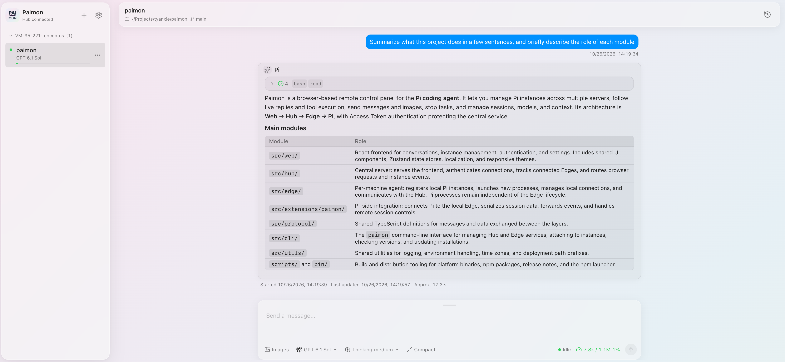

<p align="center">
  
  <br/>
  <em>Watch · Interact · Control</em>
  <br/><br/>
  <a href="README.md">中文</a> | <a href="README.en.md">English</a>
</p>

Paimon lets you talk to [Pi](https://pi.dev/) instances across multiple servers from your browser.



## Core Features

- **Multiple machines and instances**: Switch between instances and create new ones by choosing a server and working directory.
- **Live conversations**: Read streaming replies, thinking, tool status and results; send messages or stop tasks.
- **Images and diagrams**: Upload or paste images, read Markdown and Mermaid diagrams, and open enlarged previews.
- **Sessions and models**: Browse, create and switch sessions; select models and thinking levels; inspect and compact context.
- **Cross-device access**: Desktop and mobile layouts, light and dark themes, Chinese and English, and task completion notifications.
- **Authentication**: Access Token protects Hub business APIs and browser and Edge connections to Hub.

## Prerequisites

- Pi >= 1.1.0.
- macOS or Linux, with arm64 and x64 platform packages.
- Node.js >= 18 for npm installation; Bun for source installation.

## Installation

### npm (recommended)

```bash
npm install -g @tyanxie/paimon
pi install npm:@tyanxie/paimon
```

### From source

```bash
git clone https://github.com/tyanxie/paimon.git
cd paimon
bun install
bun run build
bun link
pi install .
```

## Quick Start

Start Hub and Edge on the same machine, then start Pi in your working directory:

```bash
paimon hub start
paimon edge start
pi
```

Visit `http://localhost:8080` in your browser. On your first visit, enter the Access Token printed when Hub starts.

Hub serves the Web UI, Edge manages instances on its machine, and the Pi Extension connects automatically to the local Edge. Install the Extension and start Edge on every machine running Pi.

See the [deployment guide](docs/deployment.en.md) for multiple machines, sub-paths and reverse proxies. Use a trusted network or a TLS reverse proxy for remote access.

## Development

See [AGENTS.md](AGENTS.md) for development commands and collaboration rules. Source code and tests describe implementation and interactions.

## License

MIT
