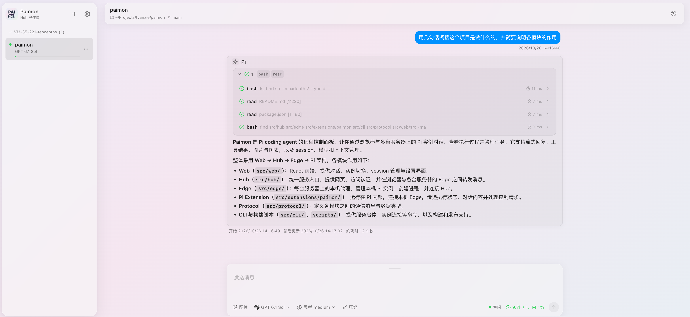

<p align="center">
  
  <br/>
  <em>守望 · 交互 · 掌控</em>
  <br/><br/>
  <a href="README.md">中文</a> | <a href="README.en.md">English</a>
</p>

Paimon，让你能在浏览器里跟所有 [Pi](https://pi.dev/) 实例对话。

## 📸 截图



## ✨ 特性

- 💬 **实时对话流** — 流式输出、思考过程、工具调用全展示
- 🛠️ **工具运行详情** — 实时显示顶层工具状态、工具提供的部分输出、错误和执行耗时，兼容历史记录
- 🖼️ **图片支持** — 粘贴或上传图片发送给 LLM，历史消息中可查看大图
- 🔄 **多实例切换** — 一个页面管理所有 pi 会话
- 🌐 **多机支持** — 中心化 Hub + 分布式 Edge，管理多台服务器上的 pi 实例
- ➕ **页面创建实例** — 选择 Edge 节点 + 路径选择器
- 📋 **Session 管理** — 浏览历史 session，一键新建或切换
- 🔒 **访问认证** — Access Token 保护所有 API 和 WebSocket 连接
- 🎨 **毛玻璃风格界面** — 清爽的 macOS 风格设计
- 🌐 **多语言支持** — 中文/英文界面，设置页一键切换
- 🔔 **任务完成通知** — 后台运行时，在自动重试、压缩恢复和排队消息全部结束后弹出系统通知
- 📱 **响应式设计** — 桌面/移动端自适应，iOS Safe Area 适配

工具运行期间刷新页面或重新连接后，通过后续更新或结束事件继续显示运行详情；最终结果也可以从历史记录获取。运行期间使用 monotonic clock 显示调用等待时间，结束后显示 Pi 提供的执行耗时。卡片右侧和详情标题共享计时值，统一显示耗时，单位使用 `s` 和 `ms`，数字与单位之间使用不换行空格。bash 详情命令区域显示提供的超时时间。

## 📋 前置要求

- [Pi](https://pi.dev/) >= 1.1.0
- Node.js >= 18（npm 安装方式）或 [Bun](https://bun.sh/)（从源码安装）

## 🚀 快速开始

Paimon 采用三层架构：

- **Hub** — 中心服务，服务 Web UI，接收 Edge 上报
- **Edge** — 每台机器上的代理，管理本机 pi 实例
- **Extension** — pi 插件，自动连接本机 Edge

### 安装

**npm 安装（推荐）**

```bash
npm install -g @tyanxie/paimon    # 安装 paimon CLI
pi install npm:@tyanxie/paimon   # 安装 pi 插件
```

**从源码安装**

```bash
git clone https://github.com/tyanxie/paimon.git && cd paimon
bun install       # 安装依赖
bun run build     # 构建前端
bun link          # 安装 paimon CLI
pi install .      # 安装 pi 插件
```

### 使用

```bash
# 启动 Hub
paimon hub start

# 启动 Edge
paimon edge start

# 启动 pi（任意目录）
pi

# 打开浏览器（首次需输入启动时输出的 Access Token）
open http://localhost:8080
```

### 多机部署

```bash
# 机器 A（Hub 所在机器）
paimon hub start --host 0.0.0.0
paimon edge start --hub ws://localhost:8080

# 机器 B（远程服务器，需指定 Hub 的 token）
paimon edge start --hub ws://<hub-ip>:8080 --token <access-token>
```

> 🔒 外部访问请使用可信网络，或通过反向代理提供 TLS。

### 反向代理部署

以 nginx 子路径部署为例：

```bash
paimon hub start --base-path /paimon
```

nginx 配置：

```nginx
location /paimon/ {
    proxy_pass http://127.0.0.1:8080;
    proxy_http_version 1.1;
    proxy_set_header Upgrade $http_upgrade;
    proxy_set_header Connection "upgrade";
    proxy_set_header Host $host;
}
```

通过 `https://<域名>/paimon/` 访问。

代理已配置 SSO 等认证时，可使用相同的 token 配置 Hub 和 nginx，实现自动登录：

```bash
paimon hub start --base-path /paimon --token <access-token>
```

在上述 nginx `location` 中增加：

```nginx
proxy_set_header Authorization "Bearer <access-token>";
```

> 🔒 代理认证应保护整个 `/paimon/` 路径，仅向可信用户开放。

## 📄 License

MIT
